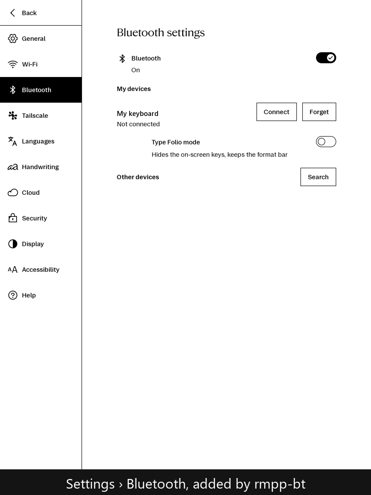

# rmpp-bt

*Settings › Bluetooth: turn Bluetooth on or off, pair, connect or forget keyboards.*

Bluetooth for the reMarkable Paper Pro: a **Settings > Bluetooth** page and a quick-settings toggle to pair and
connect keyboards. Runs without xovi and keeps working after a reboot.

Made for and tested on the reMarkable Paper Pro with OS 3.29. Other reMarkable models are not supported.
Updates for newer OS versions may take some time to follow.

> Part of the **rmpp add-ons**, built on [rmpp-packages](https://github.com/lorancecall/rmpp-packages): it is
> installed by rmpp setup, loaded into xochitl at every boot by rmpp-preload (no xovi), and kept up to date with
> Vellum. How that differs from xovi: [how it works](https://github.com/lorancecall/rmpp-packages/blob/main/docs/how-it-works.md).

## Install

Start at **[rmpp-packages](https://github.com/lorancecall/rmpp-packages#install)**: it explains developer mode and
has **rmpp setup**, the installer for all rmpp add-ons.

- In rmpp setup (the desktop app or the script), tick **Bluetooth settings and toggle** (rmpp-bt; selected by default).
- It installs `rmpp-preload` with it ([all packages and dependencies](https://github.com/lorancecall/rmpp-packages/blob/main/docs/packages.md)).
- After a reMarkable OS update: **Restore** in rmpp setup.
- Installing without rmpp setup, uninstalling, using it next to other mods, and building: [docs/install.md](docs/install.md).

## Use

- **Settings > Bluetooth:** turn Bluetooth on or off, search, pair, connect and forget devices.
- **Quick settings:** a Bluetooth toggle.
- **Keyboards:** a paired Bluetooth keyboard types in xochitl. While one is connected, the on-screen keys fold away
  and the format bar at the bottom stays. Turn on **Type Folio mode** for a keyboard (on its row in Settings >
  Bluetooth) and xochitl treats it as a Type Folio instead: the Type Folio's typing layout and paragraph format
  button. Both come from [rmpp-lang](https://github.com/lorancecall/rmpp-lang), which also types other languages.
- Bluetooth stays on across reboots when you leave it on.

## How it works

- `librmpp-bt.so` is loaded into xochitl by `rmpp-preload` (`/usr/lib/rmpp/preload.d/50-rmpp-bt.so`) and adds the
  Settings page, the sidebar entry and the quick-settings toggle (QML in `qml/`, packed into `rmpp-bt.rcc`). It talks
  to BlueZ over D-Bus (`org.bluez.Adapter1`, `Device1`, and an `Agent1` for pairing).
- The Paper Pro ships BlueZ but does not start Bluetooth. At boot, `/usr/lib/rmpp/boot.d/50-rmpp-bt` puts two units
  in `/run/systemd/system`: `rmpp-bluetooth.service` loads the NXP driver (`btnxpuart`) and starts `bluetooth.service`;
  `rmpp-bt-reconnect.service` logs adapter power and device connects.
- Everything on the root file system is in `/usr/lib/rmpp/rmpp-bt/`; it conflicts with the separate
  `bluetooth-settings` and `quicksettings-bluetooth` packages, which do the same.

## Build

Building and the development install: [docs/install.md](docs/install.md#build-and-install-by-hand).

## License

GPL-3.0-only.
